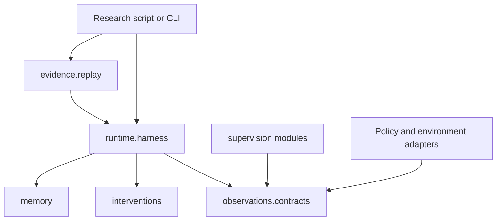

# Shared research package

Install the shared implementation as `agent-vla`; import it as `agent_vla`.
The package uses a `src/` layout so running from the repository root cannot
accidentally conceal a missing installation. It has no runtime dependencies.
Model, simulator, and GPU dependencies stay in the separate RoboTwin environments.

## Responsibility map

| Module area | Owns | Main entry points |
| --- | --- | --- |
| `runtime` | Episode execution, limits, adapter ownership, interruption | `runtime.harness.EpisodeConfig`, `run_episode` |
| `observations` | Declared sensor evidence, evaluator filtering, freshness, ordered ingestion, history | `observations.contracts`, `observations.window` |
| `supervision` | Provider transport, responses, diagnosis, retries, eligibility | `supervision.provider.BoundedSupervisorProvider`, `supervision.response` |
| `interventions` | Capability checks, adjustment bounds, recovery, budgets | `interventions.action_capabilities`, `interventions.recovery_registry` |
| `memory` | Outcome-linked experience, snapshots, fixed/adaptive memory | `memory.memory_snapshot`, `memory.fixed_memory`, `memory.adaptation_memory` |
| `evidence` | Trace integrity, deterministic replay, artifact inventory, reports | `evidence.replay.load_recorded_replay`, `TraceRecorder` |
| `evaluation` | Trial allocation, acceptance, replacement, outcome accounting | `evaluation.protocol`, `evaluation.acceptance` |

These areas organize responsibilities; they are not independent packages.
Imports are explicit. Package initializers do not eagerly load every module,
register plugins, or instantiate providers. Observation contracts depend only
on the standard library and can be used without importing episode execution.

## Interfaces and ownership

`run_episode(config, policy, environment, recorder, ...)` is the execution seam.
Callers supply adapters and release their resources. It retains existing
ownership checks, bounded dispatch, evaluator isolation, interruption behavior,
and explicit incomplete-artifact outcomes. Optional callbacks are advanced
control settings; they do not justify a second experiment class that forwards
the same settings.

The observation module is deep: it owns the declared evidence types and the
rules for sanitization, freshness, and contiguous packet ingestion. Both live
and replay adapters use those rules. Tests call the same interface as callers.
Raw observations may contain private evaluator information; only the declared
deployable projection is suitable for a supervisor.

`load_recorded_replay(path)` validates a sealed trace before exposing `run()`,
`report()`, or `evidence()`. Keep integrity validation with replay rather than
spreading it across scripts. `TraceRecorder` publishes a manifest only after
normal completion and successful finalization. A report is diagnostic evidence,
not a claim of supervisor effectiveness.

## Deliberately explicit limitations

The current observation contract still represents the inherited main/wrist
camera mapping. Some robot-state mappings, intervention capabilities, and
evaluation task allocations remain LIBERO-specific. Packaging these modules
does not make them applicable to RoboTwin's three cameras and 14 joint targets.
They must be reviewed at the simulator adapter seam; see
[the integration sequence](codebase-map.md#next-integration-work).

The unchanged `robotwin/` client runner is outside the wheel, as are the
historical `legacy/libero/` adapters. The latter remain runnable from a checkout
after package installation. This preserves the two-environment Colab setup and
avoids making simulator imports a prerequisite for CPU evidence work.

## Contributing

The RoboTwin integration has a dedicated `robotwin` adapter seam because its
three-camera, 14-joint-target contract differs from the preserved legacy harness.
It shares intervention budgets and deadline ownership, imports the unchanged
client's task/policy builders, and uses a separate journal format. The pinned
optional skill recipe imports NumPy only when executed. The wheel remains
importable without simulator, model, or NumPy dependencies. See
[the pilot contract](robotwin-pilot.md) before interpreting its outputs.

Place new behavior beside the domain responsibility it changes. Introduce an
adapter seam for a real variation, not a hypothetical future backend. Keep
model transports injectable; do not make imports contact providers or download
weights. New sensor mappings need behavior tests for missing data, timestamps,
identity, and evaluator isolation before enabling interventions.

Run the behavioral suite and wheel smoke check described in
[the research workflow](research-workflow.md). A folder move alone is not proof
of a usable distribution. [Import migration](import-migration.md) lists every
old and new module path.
